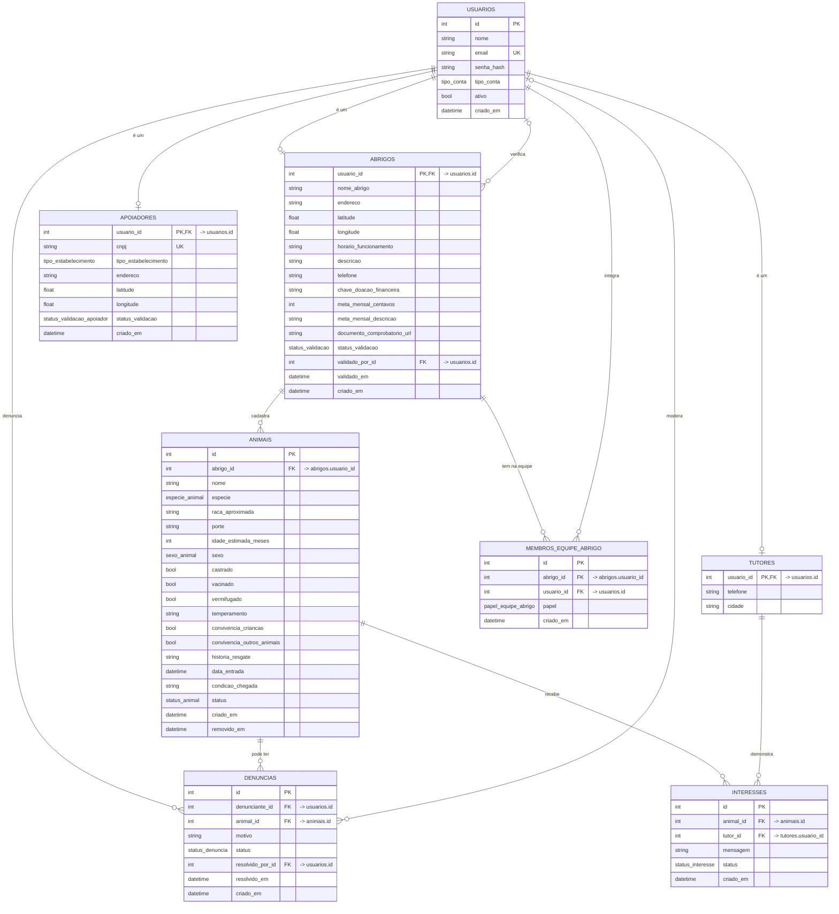
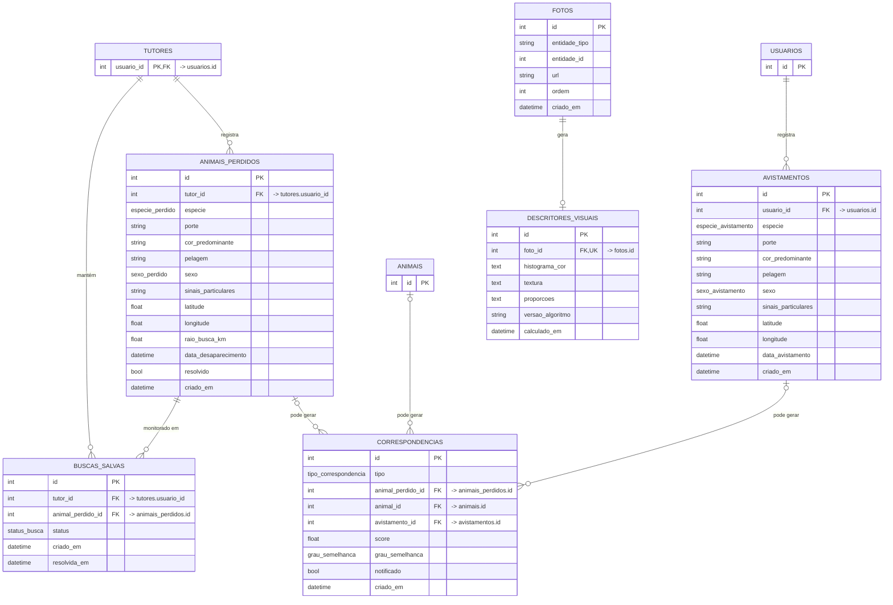
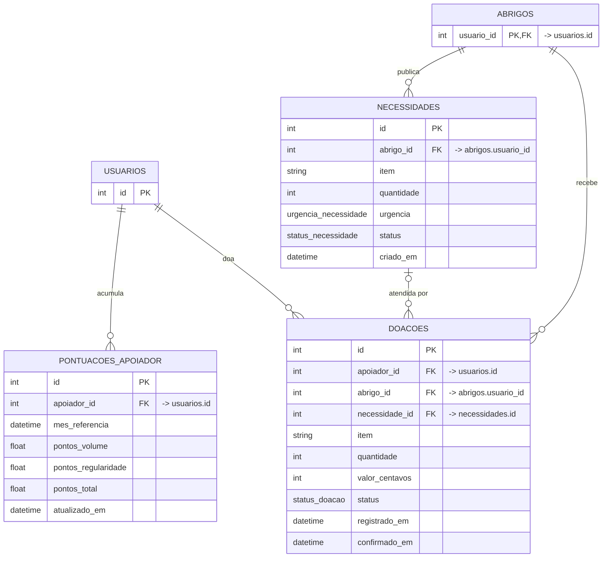
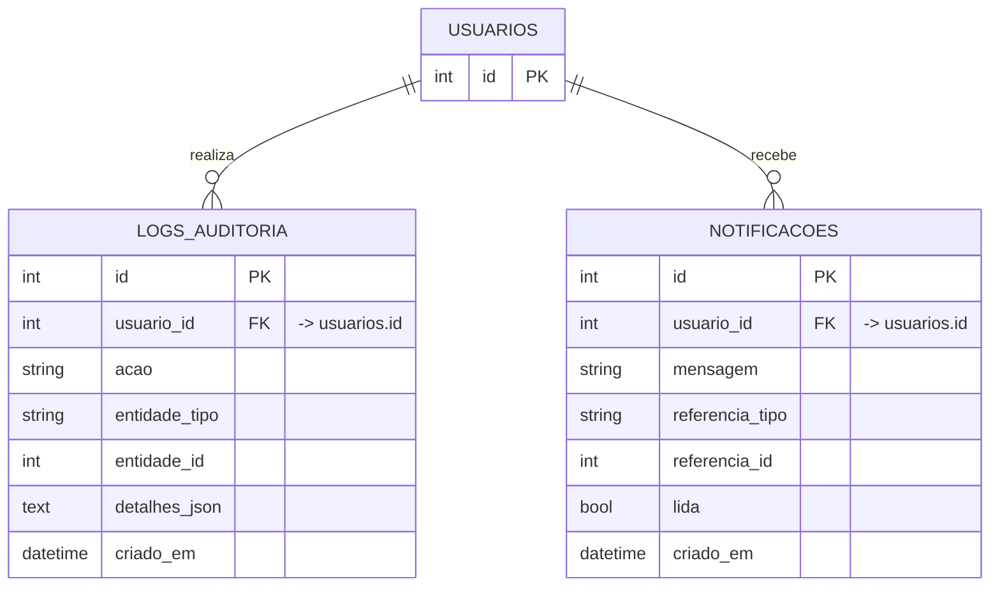

# BuscaPet — Modelo Entidade-Relacionamento (MER)

> Gerado a partir dos modelos SQLAlchemy (`api/app/models/`) por `python -m app.scripts.gerar_mer` (pasta `api/`).
> Não edite à mão. Corresponde às migrações do Alembic até a última (`alembic upgrade head`) e ao
> [`schema.sql`](schema.sql).

**19 tabelas** e **27 chaves estrangeiras**. Nas linhas: `||` um e só um, `|o` zero ou um, `o{` zero ou
muitos, `o|` zero ou um. PK = chave primária, FK = chave estrangeira (com a tabela de
destino), UK = valor único.

## Modelo completo

```mermaid
erDiagram
    USUARIOS ||--o| ABRIGOS : "é um"
    USUARIOS |o--o{ ABRIGOS : "verifica"
    ABRIGOS ||--o{ ANIMAIS : "cadastra"
    TUTORES ||--o{ ANIMAIS_PERDIDOS : "registra"
    USUARIOS ||--o| APOIADORES : "é um"
    USUARIOS ||--o{ AVISTAMENTOS : "registra"
    TUTORES ||--o{ BUSCAS_SALVAS : "mantém"
    ANIMAIS_PERDIDOS ||--o{ BUSCAS_SALVAS : "monitorado em"
    ANIMAIS_PERDIDOS |o--o{ CORRESPONDENCIAS : "pode gerar"
    ANIMAIS |o--o{ CORRESPONDENCIAS : "pode gerar"
    AVISTAMENTOS |o--o{ CORRESPONDENCIAS : "pode gerar"
    USUARIOS ||--o{ DENUNCIAS : "denuncia"
    ANIMAIS ||--o{ DENUNCIAS : "pode ter"
    USUARIOS |o--o{ DENUNCIAS : "modera"
    FOTOS ||--o| DESCRITORES_VISUAIS : "gera"
    USUARIOS ||--o{ DOACOES : "doa"
    ABRIGOS ||--o{ DOACOES : "recebe"
    NECESSIDADES |o--o{ DOACOES : "atendida por"
    ANIMAIS ||--o{ INTERESSES : "recebe"
    TUTORES ||--o{ INTERESSES : "demonstra"
    USUARIOS ||--o{ LOGS_AUDITORIA : "realiza"
    ABRIGOS ||--o{ MEMBROS_EQUIPE_ABRIGO : "tem na equipe"
    USUARIOS ||--o{ MEMBROS_EQUIPE_ABRIGO : "integra"
    ABRIGOS ||--o{ NECESSIDADES : "publica"
    USUARIOS ||--o{ NOTIFICACOES : "recebe"
    USUARIOS ||--o{ PONTUACOES_APOIADOR : "acumula"
    USUARIOS ||--o| TUTORES : "é um"

    ABRIGOS {
        int usuario_id PK, FK "-> usuarios.id"
        string nome_abrigo
        string endereco
        float latitude
        float longitude
        string horario_funcionamento
        string descricao
        string telefone
        string chave_doacao_financeira
        int meta_mensal_centavos
        string meta_mensal_descricao
        string documento_comprobatorio_url
        status_validacao status_validacao
        int validado_por_id FK "-> usuarios.id"
        datetime validado_em
        datetime criado_em
    }
    ANIMAIS {
        int id PK
        int abrigo_id FK "-> abrigos.usuario_id"
        string nome
        especie_animal especie
        string raca_aproximada
        string porte
        int idade_estimada_meses
        sexo_animal sexo
        bool castrado
        bool vacinado
        bool vermifugado
        string temperamento
        bool convivencia_criancas
        bool convivencia_outros_animais
        string historia_resgate
        datetime data_entrada
        string condicao_chegada
        status_animal status
        datetime criado_em
        datetime removido_em
    }
    ANIMAIS_PERDIDOS {
        int id PK
        int tutor_id FK "-> tutores.usuario_id"
        especie_perdido especie
        string porte
        string cor_predominante
        string pelagem
        sexo_perdido sexo
        string sinais_particulares
        float latitude
        float longitude
        float raio_busca_km
        datetime data_desaparecimento
        bool resolvido
        datetime criado_em
    }
    APOIADORES {
        int usuario_id PK, FK "-> usuarios.id"
        string cnpj UK
        tipo_estabelecimento tipo_estabelecimento
        string endereco
        float latitude
        float longitude
        status_validacao_apoiador status_validacao
        datetime criado_em
    }
    AVISTAMENTOS {
        int id PK
        int usuario_id FK "-> usuarios.id"
        especie_avistamento especie
        string porte
        string cor_predominante
        string pelagem
        sexo_avistamento sexo
        string sinais_particulares
        float latitude
        float longitude
        datetime data_avistamento
        datetime criado_em
    }
    BUSCAS_SALVAS {
        int id PK
        int tutor_id FK "-> tutores.usuario_id"
        int animal_perdido_id FK "-> animais_perdidos.id"
        status_busca status
        datetime criado_em
        datetime resolvida_em
    }
    CORRESPONDENCIAS {
        int id PK
        tipo_correspondencia tipo
        int animal_perdido_id FK "-> animais_perdidos.id"
        int animal_id FK "-> animais.id"
        int avistamento_id FK "-> avistamentos.id"
        float score
        grau_semelhanca grau_semelhanca
        bool notificado
        datetime criado_em
    }
    DENUNCIAS {
        int id PK
        int denunciante_id FK "-> usuarios.id"
        int animal_id FK "-> animais.id"
        string motivo
        status_denuncia status
        int resolvido_por_id FK "-> usuarios.id"
        datetime resolvido_em
        datetime criado_em
    }
    DESCRITORES_VISUAIS {
        int id PK
        int foto_id FK, UK "-> fotos.id"
        text histograma_cor
        text textura
        text proporcoes
        string versao_algoritmo
        datetime calculado_em
    }
    DOACOES {
        int id PK
        int apoiador_id FK "-> usuarios.id"
        int abrigo_id FK "-> abrigos.usuario_id"
        int necessidade_id FK "-> necessidades.id"
        string item
        int quantidade
        int valor_centavos
        status_doacao status
        datetime registrado_em
        datetime confirmado_em
    }
    FOTOS {
        int id PK
        string entidade_tipo
        int entidade_id
        string url
        int ordem
        datetime criado_em
    }
    INTERESSES {
        int id PK
        int animal_id FK "-> animais.id"
        int tutor_id FK "-> tutores.usuario_id"
        string mensagem
        status_interesse status
        datetime criado_em
    }
    LOGS_AUDITORIA {
        int id PK
        int usuario_id FK "-> usuarios.id"
        string acao
        string entidade_tipo
        int entidade_id
        text detalhes_json
        datetime criado_em
    }
    MEMBROS_EQUIPE_ABRIGO {
        int id PK
        int abrigo_id FK "-> abrigos.usuario_id"
        int usuario_id FK "-> usuarios.id"
        papel_equipe_abrigo papel
        datetime criado_em
    }
    NECESSIDADES {
        int id PK
        int abrigo_id FK "-> abrigos.usuario_id"
        string item
        int quantidade
        urgencia_necessidade urgencia
        status_necessidade status
        datetime criado_em
    }
    NOTIFICACOES {
        int id PK
        int usuario_id FK "-> usuarios.id"
        string mensagem
        string referencia_tipo
        int referencia_id
        bool lida
        datetime criado_em
    }
    PONTUACOES_APOIADOR {
        int id PK
        int apoiador_id FK "-> usuarios.id"
        datetime mes_referencia
        float pontos_volume
        float pontos_regularidade
        float pontos_total
        datetime atualizado_em
    }
    TUTORES {
        int usuario_id PK, FK "-> usuarios.id"
        string telefone
        string cidade
    }
    USUARIOS {
        int id PK
        string nome
        string email UK
        string senha_hash
        tipo_conta tipo_conta
        bool ativo
        datetime criado_em
    }
```

## Por módulo

O mesmo modelo em partes menores, mais fáceis de ler. Tabelas de outro módulo aparecem só com a chave primária.

### Contas e adoção

### Reencontro

### Doações

### Transversais

## Como ler o modelo

| Módulo | Tabelas |
|---|---|
| Contas e perfis | `usuarios` (login de todos) e um perfil por tipo: `tutores`, `abrigos`, `apoiadores`; `membros_equipe_abrigo` |
| Adoção | `animais`, `interesses`, `denuncias` |
| Reencontro | `animais_perdidos`, `avistamentos`, `buscas_salvas`, `correspondencias`, `fotos`, `descritores_visuais` |
| Doações | `necessidades`, `doacoes`, `pontuacoes_apoiador` |
| Transversais | `notificacoes`, `logs_auditoria` |

**Decisões de modelagem**

- **Um perfil por tipo de conta** (`tutores`, `abrigos`, `apoiadores` com chave primária = `usuarios.id`): cada
  perfil tem as próprias colunas obrigatórias, sem uma tabela única cheia de colunas vazias.
- **`fotos` é polimórfica**: pertence a um animal, a um perdido ou a um avistamento, indicado por `entidade_tipo` +
  `entidade_id`. Por isso não aparece ligada por linha no diagrama: não existe chave estrangeira para "uma de três
  tabelas" em SQL; a integridade é garantida pela API. A extração de descritores (núcleo OpenCL) trata toda foto do
  mesmo jeito, venha de onde vier.
- **`doacoes.apoiador_id` aponta para `usuarios`**, não só para `apoiadores`: doa a empresa (apoiador) e também a
  pessoa física (tutor). Doação em dinheiro tem `valor_centavos` (PIX feito fora da plataforma); a meta do mês fica em
  `abrigos.meta_mensal_centavos`. Valores sempre em centavos, inteiros.
- **`pontuacoes_apoiador` é um cache mensal** do ranking (uma linha por pessoa e mês), recalculado quando o abrigo
  confirma uma doação; o ranking do ano é a soma dos meses.
- **Nada some de verdade quando há histórico:** conta excluída fica `ativo = false`; anúncio removido pela
  moderação ganha `removido_em`. Interesses, doações, denúncias e o histórico (`logs_auditoria`) continuam apontando
  para eles.
- **`descritores_visuais`** guarda o vetor que o núcleo OpenCL calcula para cada foto (uma linha por foto), usado na
  busca por semelhança e no monitoramento das `buscas_salvas`.
